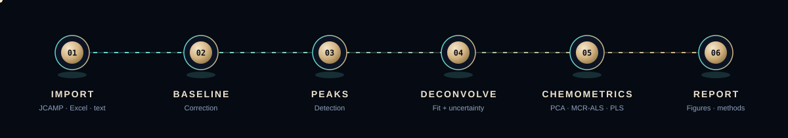

<div align="center">



<br>

[](https://github.com/asifverse4/LabScribber/actions/workflows/ci.yml)
[](LICENSE)
[](tests)
[](package.json)
[](CITATION.cff)

**[Quick start](#quick-start)** &nbsp;·&nbsp; **[Capabilities](#capabilities)** &nbsp;·&nbsp; **[Quality](#quality--reproducibility)** &nbsp;·&nbsp; **[Roadmap](#known-limitations--roadmap)** &nbsp;·&nbsp; **[Citing](#citing)**

</div>

<br>

LabScribber is a browser-based, Electron-packaged workstation for academic spectroscopy. It takes instrument data through baseline correction, peak deconvolution, chemometrics and journal-grade export in one application, and is backed by an automated suite of **177 tests** covering numerical routines and UI behaviour.

<br>

<div align="center">

</div>

<br>

[](https://doi.org/10.5281/zenodo.23688639)


## Techniques

<div align="center">

</div>

<br>

## Capabilities

| | |
|---|---|
| **Signal processing** | Baseline correction, smoothing and peak detection across all supported techniques |
| **Peak deconvolution** | Multi-peak fitting with covariance-based parameter uncertainty |
| **Solid-state analysis** | Scherrer and Williamson–Hall XRD analysis; Tauc bandgap extraction |
| **Chemometrics** | PCA, MCR-ALS, PLS and hierarchical clustering |
| **NMR** | ¹H, ¹³C and 2D COSY |
| **Electrochemistry** | Cyclic voltammetry and impedance (EIS) |
| **Reproducibility** | Session files (`.lsb`), provenance tracking and methods-section text generation |
| **Export** | Publication-oriented figures and PDF output |

## Quick start

**Requires Node.js ≥ 20.19**

```bash
git clone https://github.com/asifverse4/LabScribber.git
cd LabScribber
npm install
npm run dev
```

Open **http://localhost:3000**.

<details>
<summary><b>Desktop app, tests, production build</b></summary>

<br>

```bash
npm run electron:dev      # desktop app (Electron)
npm test                  # full test suite
npm run test:coverage     # coverage report -> coverage/index.html
npm run build             # production build
npm run electron:dist     # Windows / macOS / Linux installers
```

`electron:dist` expects `build/icon.ico`, `build/icon.icns` and `build/icon.png` (PNG at least 512×512). Add them before packaging. See [`CONTRIBUTING.md`](CONTRIBUTING.md) for the developer guide and [`docs/SESSION_FORMAT.md`](docs/SESSION_FORMAT.md) for the `.lsb` session format.

</details>

## Quality & reproducibility

- **177 automated tests** across the numerical core and the UI.
- **Continuous integration** runs type-check, tests and a production build on every push and pull request ([workflow](.github/workflows/ci.yml)).
- **Verified on synthetic data** with known ground truth; see the accompanying paper (`paper.md`).

## Known limitations & roadmap

- **Tauc auto-window selection is noise-sensitive**, even with the manual wavelength-range safeguard set correctly (paper §2.3). A scoped fix is planned.
- **AI-assisted interpretation is planned, not implemented.** A `@google/genai` dependency is declared for future work only.
- **Real-instrument validation is ongoing.** Validation on non-synthetic datasets is in progress.

Full release history: [`CHANGELOG.md`](CHANGELOG.md).

## Citing

If you use LabScribber in your research, please cite it using [`CITATION.cff`](CITATION.cff). GitHub's **Cite this repository** button reads it directly. A draft JOSS paper is included (`paper.md`, `paper.bib`) but has not been submitted.

<br>

<div align="center">

<sub>Developed at the School of Chemical and Life Sciences, Jamia Hamdard University, New Delhi, India.<br>
Created by <b>Asif Raza</b> · Contributor: <b>Huma Basheer</b> · Supervision: <b>Imran A. Khan</b> · Released under the <a href="LICENSE">MIT License</a></sub>

</div>
