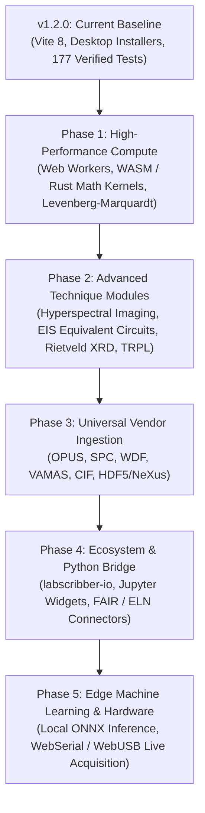

# LabScribber Strategic Roadmap & Future Scope

> **Vision**: To establish LabScribber as the premier open-source, client-first, multi-technique spectroscopy workstation for physical sciences, nanotechnology, and analytical chemistry—delivering journal-grade numerical precision, seamless instrument interoperability, and cryptographic reproducibility with zero installation barriers.

---

## 🗺️ Architectural Philosophy & Core Tenets

1. **Client-First & Privacy Preserving**: Scientific data never leaves the user's machine without explicit user action. All matrix factorizations, deconvolution loops, and baseline transforms execute locally in browser memory or the packaged desktop runtime.
2. **Numerical Rigor Over Approximation**: Asymptotic parameter uncertainty estimation (\(\hat{\sigma}^2(J^\top J)^{-1}\)), rigorous propagation of errors via the delta method, and ground-truth verified benchmarks are mandatory for every new analytical module.
3. **Open Science & FAIR Compliance**: Findable, Accessible, Interoperable, and Reusable (FAIR) spectral data pipelines with automated provenance logging, checksum validation, and bi-directional session interchange formats.
4. **Universal Multi-Technique Ingestion**: Breaking vendor lock-in across spectroscopy disciplines (UV-Vis, FTIR, Raman, NMR, XPS, PL, XRD, CV, EIS) through standardized, battle-tested open parsers.

---

## 📍 Multi-Phase Strategic Milestones



---

## 🔬 Phase 1: High-Performance Numerical Core & Compute Acceleration

### 1.1 Web Worker Offloading for Nonlinear Solvers
- **Current state**: Nelder-Mead simplex optimization, Asymmetric Least Squares (ALS) baseline correction, and Shirley background calculations run on the main browser thread.
- **Future Scope**:
  - Offload heavy deconvolution pipelines and matrix operations to dedicated background Web Workers with transferable `ArrayBuffer` payloads.
  - Maintain fluid 60 FPS UI rendering and real-time canvas updates during complex 10+ peak multi-component fits.
  - Add cooperative worker cancellation and progressive residual streaming for interactive progress tracking.

### 1.2 WebAssembly (WASM) / Rust Computational Acceleration
- **Target**: Near-native C/Fortran throughput for large hyperspectral datasets and iterative matrix inversions.
- **Deliverables**:
  - Port core matrix operations (Cholesky factorization, Banded Cholesky linear solves, Singular Value Decomposition) to optimized Rust/WASM kernels.
  - Implement the **Levenberg-Marquardt (LM)** algorithm with analytical Jacobian derivations for Gaussian, Lorentzian, Voigt, and Doniach-Šunjić (XPS) lineshapes alongside the current Nelder-Mead simplex.
  - Implement fast FFT-based deconvolution and convolution operations for instrumental broadening subtraction.

### 1.3 WebGPU Batch Tensor Acceleration
- Parallel evaluation of chemometrics algorithms (MCR-ALS, PCA, PLS regression) across thousands of spectra simultaneously using WebGPU compute shaders.

---

## 🧪 Phase 2: Domain Expansion & Advanced Spectroscopy Techniques

### 2.1 Hyperspectral & Chemical Imaging
- **2D/3D Spectral Map Explorer**: Ingestion and visualization of hyperspectral Raman maps, FTIR microspectroscopy grids, and XPS line scans/depth profiles.
- **Spatial False-Color Mapping**: Integrated intensity, peak ratio (e.g. D/G band ratio in carbon materials), and component concentration heatmaps superimposed on optical sample micrographs.
- **Spatial Region-of-Interest (ROI) Extraction**: Interactive polygon and rectangular ROI selection with instantaneous average spectrum generation and baseline extraction.

### 2.2 Advanced Powder X-Ray Diffraction (PXRD) & Crystallography
- **Crystallography Open Database (COD) Integration**: In-app query and comparison against open crystal structures.
- **Rietveld & Le Bail Refinement**:
  - Full-profile pattern decomposition, lattice parameter refinement (\(a, b, c, \alpha, \beta, \gamma\)), and peak asymmetry corrections (Caglioti function).
  - Quantitative phase analysis (QPA) for multi-phase mixtures.
  - CIF (Crystallographic Information File) parser and 3D unit cell visualizer.

### 2.3 Electrochemical Impedance Spectroscopy (EIS) Equivalent Circuit Modeling
- **Complex Nonlinear Least Squares (CNLS)** fitting for impedance spectra (\(Z' + jZ''\)).
- **Interactive Circuit Designer**: Drag-and-drop equivalent circuit builder supporting resistors (\(R\)), capacitors (\(C\)), constant phase elements (\(Q\) / CPE), Warburg impedance (\(W\)), and Gerischer elements.
- **Bode & Nyquist Dual Plots**: Simultaneous real-time parameter tracking and residual phase/magnitude plots.

### 2.4 Time-Resolved Photoluminescence (TRPL) & Photophysics
- **Multi-Exponential Decay Deconvolution**: Fitting single-, bi-, and tri-exponential photoluminescence lifetime traces (\(I(t) = \sum A_i e^{-t/\tau_i}\)).
- **Instrument Response Function (IRF) Reconvolution**: Iterative reconvolution with measured prompt laser pulses to extract sub-nanosecond lifetimes.

### 2.5 Advanced NMR Suite
- **Phasing & Apodization**: Interactive zero-order and first-order manual/automatic phase correction; window function multiplication (exponential, Gaussian, sine-bell).
- **2D NMR Spectral Viewer**: Contour plot rendering and peak cross-hair alignment for COSY, HSQC, and HMBC spectra.

---

## 📂 Phase 3: Universal Ingestion & Vendor Format Interoperability

While ASCII CSV/TSV and JCAMP-DX are supported, proprietary binary formats remain the standard raw output from commercial spectrometers.

### 3.1 Direct Binary Instrument Parsers
- **Bruker OPUS (`.0`, `.1`, `.s*`)**: Native pure-JS/WASM binary decoder for vibrational (FTIR/Raman) spectra without requiring Bruker desktop software.
- **Thermo Galactic SPC (`.spc`)**: Full support for multi-trace, multiplexed, and unevenly-spaced SPC binary files.
- **Thermo OMNIC SPA (`.spa`)**: Binary decoding for Thermo Nicolet FTIR spectrometers.
- **Renishaw WiRE WDF (`.wdf`)**: Direct parsing of Raman single spectra, time-series, and 2D mapping data.
- **ISO 14976 VAMAS (`.vms`, `.npl`)**: Complete support for XPS and AES surface chemical analysis files, preserving analyzer mode, pass energy, and work function metadata.

### 3.2 Synchrotron & Neutron Data Standards
- **NeXus / HDF5 (`.nxs`, `.h5`)**: Client-side parsing using WebAssembly-backed HDF5 reader for beamline and synchrotron facility exports.

---

## 🔗 Phase 4: Open Science, FAIR Data, and Reproducibility

### 4.1 Python & Jupyter Ecosystem Bridge (`labscribber-io`)
- Publish an open-source Python library (`labscribber-io`) on PyPI:
  ```python
  import labscribber as lsb

  # Load session created in browser / desktop
  session = lsb.load_session("catalyst_run.lsb")
  df = session.datasets[0].to_dataframe()
  fit_results = session.datasets[0].deconvolution_results
  ```
- Bi-directional export: export Python analysis scripts that exactly reproduce the visual pipeline executed in LabScribber.

### 4.2 Electronic Lab Notebook (ELN) & Repository Connectors
- **Direct Zenodo / OSF Export**: Export processed datasets, methodology provenance, and figure bundles directly to Zenodo or Open Science Framework with automated DOI assignment metadata.
- **ELN Interoperability**: Formatted JSON/Markdown bundle export tailored for integration into openBIS, LabArchives, eLabFTW, and Benchling.

### 4.3 Publication-Ready Multi-Panel Figure Studio
- **Composite Layout Editor**: Multi-panel figure arrangements (e.g., 2×2, 1×3, inset zoom panels) with synchronized X-axis linking and shared legend controls.
- **Journal Style Presets**: One-click typography, line-weight, and aspect ratio formatting conforming to major publishers (Nature Publishing Group, American Chemical Society, Royal Society of Chemistry, Elsevier, Wiley).
- **Direct Vector Export**: Enhanced PDF/SVG output with embedded vector text and LaTeX equation formatting for axis labels (\(\nu / \text{cm}^{-1}\), \(2\theta / ^\circ\), \(\delta / \text{ppm}\)).

---

## 🤖 Phase 5: On-Device Edge Machine Learning & Hardware Interfacing

### 5.1 Local & Offline AI Spectral Interpretation
- **100% On-Device Inference**: Using ONNX Runtime Web (WASM / WebGL) with zero data transmission to external cloud services:
  - **FTIR Functional Group Assistant**: Automated identification of characteristic vibrational frequencies (carbonyls, amides, hydroxyls, C-H stretching) with statistical confidence metrics.
  - **Raman Mineral & Polymorph Screening**: Spectral library matching against verified open databases (e.g. RRUFF Project).
  - **Smart Baseline Guidance**: Machine learning classification of baseline topography to recommend optimal polynomial, ALS, or Shirley parameters.

### 5.2 Direct Hardware Interfacing (Live Data Acquisition)
- **Web Serial & WebUSB APIs**:
  - Live data stream capture from portable, USB-connected micro-spectrometers (e.g., Ocean Insight, Hamamatsu mini-spectrometers, Thorlabs sensors).
  - Custom DIY lab hardware support (Arduino / ESP32 / Raspberry Pi automated potentiostats and photodetectors).
  - Real-time oscilloscope-style spectral preview and continuous background subtraction during acquisition.

---

## 📊 Summary Roadmap Matrix

| Milestone | Target Horizon | Key Capabilities | Core Tech |
| :--- | :--- | :--- | :--- |
| **v1.3.0** | Near-Term | Web Worker offloading, Levenberg-Marquardt solver, improved Tauc window safeguard | Web Workers, TypeScript |
| **v1.4.0** | Near-Term | Bruker OPUS & Thermo SPC binary parsers, residual plot inspection, $R^2$/$\chi^2$ metrics | Binary ArrayBuffer decoders |
| **v2.0.0** | Mid-Term | Hyperspectral 2D mapping, EIS equivalent circuit modeling, WASM-accelerated math core | Rust / WebAssembly, WebGL |
| **v2.1.0** | Mid-Term | Powder XRD Rietveld refinement, COD database search, CIF unit cell viewer | WASM, 3D WebGL |
| **v2.2.0** | Long-Term | `labscribber-io` Python package, Zenodo/ELN bridge, journal multi-panel figure editor | Python, Jupyter, SVG/PDF |
| **v3.0.0** | Long-Term | On-device ONNX spectral matching, WebSerial live instrument acquisition | ONNX Runtime Web, WebUSB |

---

## 🤝 Community Feedback & Contributions

LabScribber's roadmap is driven by research practitioners across academic, governmental, and industrial laboratories. If you require support for a specific spectroscopy technique, custom vendor format, or analytical workflow:
- Open a feature discussion on [GitHub Discussions](https://github.com/asifverse4/LabScribber/discussions).
- Submit bug reports and feature requests via [GitHub Issues](https://github.com/asifverse4/LabScribber/issues).
- Review our [Contributing Guide](CONTRIBUTING.md) to propose algorithm implementations or test cases.

